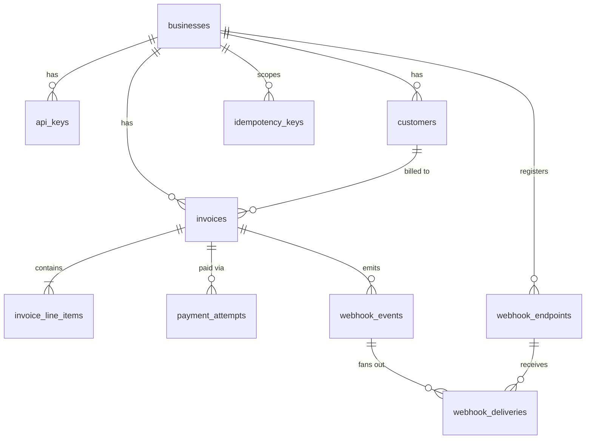
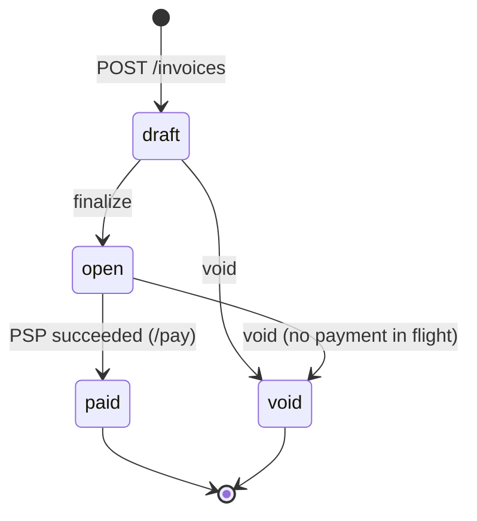

# Design

Rust (Axum 0.8) + PostgreSQL (sqlx, embedded migrations). One service binary plus a mock PSP binary; the service also runs two background tasks (webhook worker, payment sweeper). Postgres is the only coordination point, so any number of instances can run side by side.

Request flow: `HTTP → AuthBusiness extractor → handler → Postgres tx (state change + outbox rows) → response`. Later, off the request path: `webhook worker → business endpoint`, and `sweeper → PSP`.

## 1. Data model

- **Keys:** UUID primary keys (`gen_random_uuid()`): unguessable in URLs, no coordination needed. Costs index locality versus bigserial; acceptable here.
- **Tenancy in the schema:** `invoices` has a composite FK `(customer_id, business_id) → customers(id, business_id)`, so an invoice can never point at another business's customer, even through a buggy query. Handlers additionally filter every query by `business_id`.
- **Money:** `total_cents bigint`, `unit_amount_cents bigint`, `quantity integer`. `invoice_line_items.amount_cents` is a `GENERATED ALWAYS … STORED` column (`quantity::bigint * unit_amount_cents`), so a line total can't disagree with its inputs, and overflow errors rather than wraps. The invoice total is computed once, in Rust, with `checked_mul`/`checked_add`.
- **Invariants as CHECKs:** state is one of four values; `paid_at IS NOT NULL ⇔ state='paid'`; `open`/`paid` require `total_cents > 0`; a `succeeded` attempt has a `psp_ref`, a `failed` one a `failure_code`.
- **`payment_attempts`:** append-only history of tries; its `id` doubles as the PSP idempotency key. Two **partial unique indexes** are the double-charge backstop: one in-flight (`pending` or `unknown`) attempt per invoice (migration 0006), one `succeeded` per invoice. A third unique index `(invoice_id, idempotency_key)` ties a client key to one attempt.
- **`idempotency_keys`:** PK `(business_id, key)`, stores `request_hash` and the final `response_status`/`response_body` for replay.
- **Outbox:** `webhook_events` (immutable log) → `webhook_deliveries` (one row per event × endpoint; `UNIQUE(event_id, endpoint_id)`; partial index `WHERE status='pending'` on `next_attempt_at` keeps the worker's poll tiny).
- **Why this shape over alternatives:** line items in a table, not a JSON column, so they're constrained and queryable; payments as rows, not columns on the invoice, because an invoice can have many failed tries; a separate delivery row per endpoint so retries are tracked independently.
- **At 100× scale:** replace offset pagination with keyset (indexes `(business_id, created_at DESC, id DESC)` already exist for it); partition `webhook_events`/`webhook_deliveries` by month and archive; TTL-delete `idempotency_keys` (index on `created_at` exists); move the worker/sweeper to dedicated instances; read replica for GETs; larger connection pool behind PgBouncer (currently 10).

## 2. Invoice state machine

- **Why `draft`:** an invoice should be editable/reviewable before it's collectible; `finalize` is the deliberate point where it becomes payable. Creating straight into `open` was rejected.

## 3. Payment correctness & failure modes

**Mechanism.** `/pay` is two short transactions around the PSP call, with **no lock held during the call**:

1. **Tx 1:** insert the idempotency key → `SELECT … FOR UPDATE` the invoice → require `state='open'` → require no `pending`/`unknown` attempt → insert a `pending` attempt → commit.
2. **PSP call** (5 s timeout) keyed by the attempt id.
3. **Tx 2:** `UPDATE payment_attempts … WHERE status IN ('pending','unknown')` (status-conditional) → `UPDATE invoices SET state='paid' WHERE state='open'` → insert outbox event → store the idempotent response → commit.

Why a row lock plus conditional updates, over alternatives: an advisory lock or holding the row lock through the PSP call would pin a connection for up to 30 s per slow payment; `SERIALIZABLE` would force retry loops on every conflict; pure optimistic versioning would let both requests reach the PSP before one loses. The row lock is held for milliseconds, and the partial unique indexes catch any logic bug at the schema level.

**(a) Two simultaneous `/pay` calls.** Both enter Tx 1; the invoice row lock serializes them. The second sees either a `pending` attempt (`409 payment_in_progress`) or an already `paid` invoice (`409 invoice_not_payable`). One charge, at most one `succeeded` attempt (guaranteed by the unique index even if the check were wrong).

**(b) PSP times out (`tok_timeout`, 30 s).** The call is cut at 5 s. A timeout is *unknown*, not *failed*: the attempt stays `pending`, the invoice stays `open` (and locked against new attempts and against void), and the endpoint returns **`202` with `status: "pending"`**, never hanging. The sweeper (every 10 s) re-drives attempts older than 15 s using the *same* PSP key; the PSP returns the original result, and Tx 2 resolves it. After 120 s unresolved it becomes `unknown` (alert-worthy, still locked) and is re-checked about once a minute, so nothing is stuck forever. The caller finds out by replaying the same `Idempotency-Key` (returns current state) or via the `invoice.paid` / `invoice.payment_failed` webhook. `tok_network_error` (HTTP 500) follows the same path. *We deliberately do not treat a 5xx as a decline:* that could leave a charged card on an unpaid invoice.

**(c) PSP succeeds, service crashes before Tx 2.** The attempt is still `pending` in the DB. On restart the sweeper re-asks the PSP with the same attempt id; a real PSP dedups on that key and returns the original success rather than charging again, then Tx 2 runs. If the client retries with its original key, it gets `202` (or the final result once resolved) and no new attempt is created. Double-charge is prevented by (1) the PSP idempotency key, (2) the blocked invoice, (3) the unique index on succeeded attempts.

**(d) Same idempotency key, different body.** `request_hash = SHA-256("POST /invoices/{id}/pay\n{card_token}")` is compared against the stored one → `422 idempotency_key_reuse`. The hash covers meaning, not raw bytes, so whitespace/key order doesn't matter. Same key + same body → the stored response, header `Idempotent-Replayed: true`, no PSP call. The key row is inserted inside Tx 1, so a crash can't leave a key without an attempt, and a request rejected by business rules (e.g. invoice not open) rolls back the key so it isn't "burned". A concurrent duplicate blocks on the key insert until the first transaction commits, then replays.

**(e) `/pay` on a `paid` invoice.** New key → `409 invoice_not_payable`, no attempt created. Same key as the original → the original `200` is replayed.

## 4. Webhook design

- **Signing:** `Webhook-Signature: t=<unix>,v1=hex(HMAC-SHA256(secret, "<t>.<raw body>"))`. Receivers recompute over raw bytes, compare in constant time, and reject if `|now − t| > 5 min` (replay protection). Timestamp is refreshed on each attempt so retries aren't rejected. Per-endpoint `whsec_…` secret (244 bits CSPRNG), shown once.
- **Retry policy:** attempts at t=0, then +10 s, +30 s, +2 min, +10 min, +1 h, +6 h → **7 attempts, ≈ 7 h 13 m** total; then `status='failed'` (dead letter). 10 s HTTP timeout, 3 s connect timeout, redirects treated as failure. Any `2xx` is success.
- **Delivery semantics:** at-least-once. Claim = one `UPDATE … FOR UPDATE SKIP LOCKED` that also pushes `next_attempt_at` 60 s ahead (a lease), so multiple instances never double-claim and a crashed worker's rows reappear after the lease. Receivers dedupe on `Webhook-Id` (event id, constant across retries).
- **Decoupled from the API path:** the handler writes `webhook_events` + `webhook_deliveries` **in the same transaction** as the state change (transactional outbox), so an event exists iff the change committed, and no business server's latency or outage can slow down or fail a payment. A worker polling every second does the HTTP.
- **Exhausted retries / reconciliation:** the event remains in `webhook_events` and the delivery row records `last_status_code`/`last_error`. **Gap:** the log is the foundation for reconciliation, but I did not build the `GET /events?since=` endpoint or a manual redelivery endpoint; today a business can still reconcile with `GET /invoices?state=` (state is the source of truth, webhooks are notifications).

## 5. API key model

- **Format:** `sk_<prefix>_<random>`; the prefix is a non-secret lookup handle (unique index).
- **Storage:** only the prefix and `SHA-256(full key)` are stored; plaintext exists only at creation. SHA-256 rather than bcrypt/argon2 because the key is high-entropy random (nothing to brute-force) and auth runs on every request.
- **Transmission:** `Authorization: Bearer` over TLS (TLS terminates in front of the service in production; the demo is plain HTTP).
- **Check:** lookup by prefix where `revoked_at IS NULL`, constant-time hash comparison; unknown prefix / wrong secret / revoked all return the same `401`. Key length capped at 128 bytes before hashing.
- **Revocation / rotation:** set `revoked_at` (soft delete, audit trail kept); effective on the next request because nothing is cached. Rotation = add a second key, migrate the client, revoke the old one (multiple active keys per business are supported).
- **Bootstrap:** keys are not minted over the API; migration `0005` seeds a demo business and key for development. Production would use an admin CLI and delete that migration.
- **Blast radius:** a leaked key exposes only its business's customers, invoices and payments (tenant filter + composite FK), can create and pay invoices and register webhook endpoints, and is revocable without touching other keys. A DB leak exposes no usable keys, but does expose webhook secrets (below).

## 6. What I cut and why

- **Refunds / partial payments:** out of scope; I'd add a `refunds` table referencing the succeeded attempt and an `amount_refunded_cents` guard, leaving `payment_attempts` append-only.
- **Cursor pagination:** offset/limit is used; list responses are wrapped in `{data}` so a cursor can be added without breaking clients. Fine at this size; slow deep pages at scale.
- **Key management & webhook-endpoint CRUD:** no endpoints to mint/revoke keys or to list/disable/rotate webhook endpoints. Bootstrap by migration instead of an unauthenticated admin API.
- **Reconciliation API (`GET /events`) and manual webhook redelivery:** data model supports it; the surface was not worth the time.
- **Rate limiting, per-state webhook events (e.g. `invoice.voided`), email:** only the three required events exist; limits discussed below.

## 7. Production readiness gap

1. **Observability:** structured logs exist, but no metrics, tracing or alerting. Needed first: alerts on attempts stuck `unknown`, dead-lettered deliveries, sweeper failures, PSP latency/error rate, webhook backlog age.
2. **Abuse protection and audit:** per-key rate limiting (token bucket at the edge, tighter on `/pay` to blunt card testing), an audit log of key use and state changes, and an admin path for key issuance/revocation.
3. **Secrets and recovery tooling:** webhook secrets are plaintext in the DB (the worker must read them) and need envelope encryption/KMS; plus the events reconciliation/redelivery API, a dead-letter replay tool, and an automated test suite (concurrency, idempotency and PSP-failure tests are not yet written) running in CI.

Smaller known gaps: sweeper re-drives up to 20 attempts serially (5 s each); no graceful shutdown for in-flight deliveries; `idempotency_keys` cleanup job not implemented; demo-seed migration must be removed.
