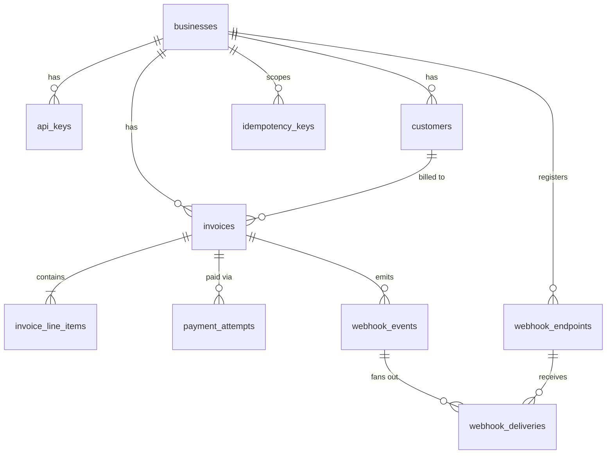
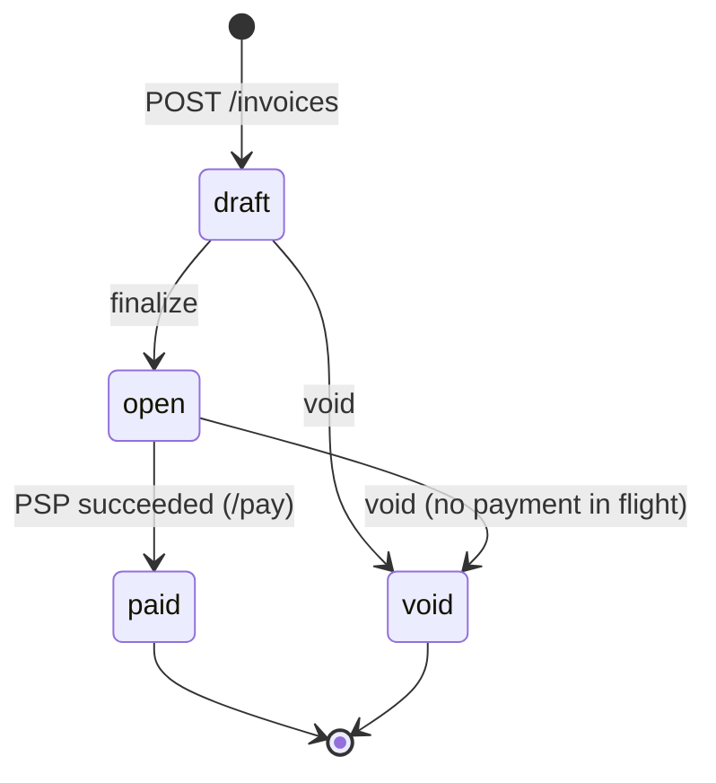

# Design

Rust (Axum) + PostgreSQL (sqlx, embedded migrations), plus a mock PSP binary. The service runs two background tasks, a webhook worker and a payment sweeper. Postgres is the only shared state, so instances can run side by side.

Request flow: `auth → handler → Postgres tx (state change + outbox rows) → response`; later, off the request path, `worker → business endpoint` and `sweeper → PSP`.

## 1. Data model

Primary keys are UUIDs (`gen_random_uuid()`): unguessable in URLs, no coordination needed; worse index locality than bigserial, acceptable here.

| Table | Shape | Indexes / constraints |
|---|---|---|
| `api_keys` | `prefix`, `key_hash` (SHA-256), `revoked_at` | `prefix` UNIQUE; `(business_id)` |
| `customers` | `name`, `email` | `UNIQUE(id, business_id)` (FK target); `(business_id, created_at DESC, id DESC)` |
| `invoices` | `state`, `total_cents bigint`, `due_date`, `paid_at` | FK `(customer_id, business_id) → customers`; CHECK state ∈ 4 values; CHECK `paid_at` set ⇔ `paid`; CHECK `open`/`paid` ⇒ total > 0; `(business_id, state, created_at DESC, id DESC)` |
| `invoice_line_items` | `quantity int`, `unit_amount_cents bigint`, `amount_cents` GENERATED | `UNIQUE(invoice_id, position)` |
| `payment_attempts` | `status` pending/succeeded/failed/unknown, `amount_cents`, `psp_ref`, `failure_code` | partial UNIQUE `(invoice_id) WHERE status IN ('pending','unknown')`; partial UNIQUE `(invoice_id) WHERE status='succeeded'`; UNIQUE `(invoice_id, idempotency_key)` |
| `idempotency_keys` | PK `(business_id, key)`, `request_hash`, stored response | `(created_at)` for cleanup |
| `webhook_endpoints` | `url`, `secret`, `is_active` | `(business_id) WHERE is_active` |
| `webhook_events` | `type`, `payload jsonb` (immutable log) | `(business_id, created_at, id)` |
| `webhook_deliveries` | `status`, `attempts`, `next_attempt_at`, last result | UNIQUE `(event_id, endpoint_id)`; `(next_attempt_at) WHERE status='pending'` |

Why this shape:
- **Tenancy in the schema:** the composite FK means an invoice can't reference another business's customer, even through a buggy query; handlers also filter by `business_id`.
- **Integer cents end to end.** `amount_cents` is a generated column, so it can't disagree with its inputs; the total is computed once in Rust with checked arithmetic.
- **Line items as a table, not JSON** (constrained, queryable); **payments as rows** (many tries per invoice), with partial unique indexes making a double charge impossible at the schema level.

**At 100× scale:** keyset pagination (indexes already match it); monthly partitions for `webhook_events`/`webhook_deliveries`; TTL job for `idempotency_keys`; worker and sweeper on dedicated instances; read replica; PgBouncer instead of a 10-connection pool.

## 2. Invoice state machine

- **Terminal:** `paid`, `void`. **Nothing is reversible.** A failed payment does not change state; the invoice stays `open` for another try. Refunds or reopening would be new, explicit transitions.
- **Why `draft`:** a draft is reviewable but not collectible, and can be voided with no customer impact. `finalize` is the explicit point where it becomes payable. Creating invoices straight into `open` was rejected.
- **Enforcement:** `allowed_sources(to)` in `src/router/invoices.rs` is the single table of manual transitions. It runs after `SELECT … FOR UPDATE` on the invoice row, so the check and the update are atomic. A violation returns `409 invalid_state_transition`. `open → paid` is reachable only through `payments::finalize`, as `UPDATE … WHERE state='open'`. `void` is also refused (`409 payment_in_progress`) while an attempt is `pending`/`unknown`, because the card may already be charged.

## 3. Payment correctness & failure modes

**Mechanism.** `/pay` is two short transactions around the PSP call, with **no lock held during the call**:

1. **Tx 1:** insert the idempotency key → `SELECT … FOR UPDATE` the invoice → require `state='open'` → require no `pending`/`unknown` attempt → insert a `pending` attempt → commit.
2. **PSP call** (5 s timeout), using the attempt id as the PSP idempotency key.
3. **Tx 2:** `UPDATE payment_attempts … WHERE status IN ('pending','unknown')` → `UPDATE invoices SET state='paid' WHERE state='open'` → insert outbox event → store the idempotent response → commit.

Why a row lock plus status-conditional updates: a lock held through the PSP call would pin a connection for up to 30 s; `SERIALIZABLE` forces retry loops; optimistic versioning lets both requests reach the PSP before one loses. The row lock lasts milliseconds, and the partial unique indexes catch logic bugs.

**(a) Two simultaneous `/pay` calls.** With different idempotency keys, both enter Tx 1 and the invoice row lock serializes them. The second sees a `pending` attempt (`409 payment_in_progress`) or a `paid` invoice (`409 invoice_not_payable`). With the same key, the second blocks on the key insert until the first commits, then replays its result. Either way there is one PSP charge, and the unique index allows at most one `succeeded` attempt.

**(b) PSP times out (`tok_timeout`, 30 s).** The call is cut at 5 s. A timeout means *unknown*, not *failed*: the attempt stays `pending`, the invoice stays `open` and is locked against new attempts and against `void`, and the endpoint returns **`202`, `status: "pending"`** without hanging. Every 10 s the sweeper re-drives attempts older than 15 s with the *same* PSP key; the PSP returns the original result and Tx 2 records it. After 120 s unresolved the attempt becomes `unknown` (alert-worthy, still locked) and is re-checked about once a minute. The caller learns the result by replaying the same `Idempotency-Key` or from the webhook. `tok_network_error` (HTTP 500) takes the same path; a 5xx is deliberately not a decline, since the card may have been charged.

**(c) PSP succeeds, service crashes before Tx 2.** The attempt is still `pending`. After restart the sweeper re-asks the PSP with the same attempt id; the PSP dedups on that key and returns the original success without charging again, and Tx 2 runs. A client retry with the original key gets `202` (or the final result), never a new attempt. Three layers prevent a double charge: PSP idempotency key, locked invoice, unique index on succeeded attempts.

**(d) Same idempotency key, different body.** `request_hash = SHA-256("POST /invoices/{id}/pay\n{card_token}")` doesn't match the stored hash → `422 idempotency_key_reuse`. Same key and body → the stored response with `Idempotent-Replayed: true`, no PSP call. The key is claimed inside Tx 1, so a crash can't leave a key without an attempt, and a request rejected by business rules rolls the key back instead of burning it.

**(e) `/pay` on a `paid` invoice.** New key → `409 invoice_not_payable`, no attempt created. Same key as the original → the original `200` is replayed.

(a), (b), (d) and (e) are covered by `tests/payments.rs`.

## 4. Webhook design

- **Signing:** `Webhook-Signature: t=<unix>,v1=hex(HMAC-SHA256(secret, "<t>.<raw body>"))`. Receivers compare in constant time and reject `|now − t| > 5 min` (replay protection); the timestamp is refreshed per attempt. Per-endpoint `whsec_…` secret, shown once.
- **Retry policy:** attempts at t=0, then +10 s, +30 s, +2 min, +10 min, +1 h, +6 h → **7 attempts, ≈ 7 h 13 m**, then `status='failed'` (dead letter). 10 s HTTP timeout, 3 s connect timeout, and redirects count as failures. Any `2xx` is success.
- **Delivery semantics:** at-least-once. One `UPDATE … FOR UPDATE SKIP LOCKED` claims rows and pushes `next_attempt_at` 60 s ahead as a lease: no double-claiming, and a crashed worker's rows return. Receivers dedupe on `Webhook-Id` (constant across retries).
- **Decoupled from the API path:** the handler writes `webhook_events` and `webhook_deliveries` **in the same transaction** as the state change (transactional outbox). An event exists iff the change committed, and no receiver's latency or outage can slow or fail a payment. A worker polling every second does the HTTP.
- **Exhausted retries / reconciliation:** the event stays in `webhook_events`, and the delivery row keeps `last_status_code`/`last_error`. **Gap:** I did not build `GET /events?since=` or manual redelivery. Today a business reconciles with `GET /invoices?state=`: invoice state is the source of truth, and webhooks are notifications.

## 5. API key model

- **Format and storage:** `sk_<prefix>_<random>`. Only the prefix (a non-secret lookup handle with a unique index) and `SHA-256(full key)` are stored; the plaintext exists only at creation. SHA-256 instead of bcrypt/argon2 because the key is high-entropy (nothing to brute-force) and auth runs on every request.
- **Transmission and check:** `Authorization: Bearer` over TLS. Look up by prefix where `revoked_at IS NULL`, compare hashes in constant time; every failure returns the same `401`.
- **Revocation / rotation:** set `revoked_at` (soft delete, audit trail kept), effective on the next request because nothing is cached. Rotation: add a second key, move the client, revoke the old one.
- **Bootstrap:** keys are not minted over the API. Migration `0005` seeds a demo business and key; production would use an admin CLI and delete that migration.
- **Blast radius:** a leaked key exposes only its own business's data (tenant filter + composite FK). It can create and pay invoices and register webhook endpoints, and it can be revoked without touching other keys. A database leak exposes no usable API keys, but does expose webhook secrets (§7).

## 6. What I cut and why

- **`uncollectible` (write-off) state:** `void` already covers abandoning an invoice. Write-off accounting belongs with refunds and dunning, which are out of scope.
- **Refunds / partial payments:** I'd add a `refunds` table referencing the succeeded attempt with an `amount_refunded_cents` guard, keeping `payment_attempts` append-only.
- **Editing draft invoices:** line items are immutable after creation. Fixing a draft means voiding it and creating a new one.
- **Cursor pagination:** offset/limit is used. Lists are wrapped in `{data}` so a cursor can be added without breaking clients.
- **Key management, webhook-endpoint CRUD, `GET /events`, redelivery:** the data model supports them; the API surface wasn't worth the time.

## 7. Production readiness gap

1. **Observability:** structured logs exist, but no metrics, tracing or alerting. First priorities: alerts on attempts stuck in `unknown`, dead-lettered deliveries, sweeper failures, PSP latency/error rate, and webhook backlog age.
2. **Abuse protection and audit:** per-key rate limiting (token bucket at the edge, tighter on `/pay` to blunt card testing), an audit log of key use and state changes, and an admin path for issuing and revoking keys.
3. **Secrets and recovery tooling:** webhook secrets are plaintext in the database (the worker must read them) and need envelope encryption/KMS. Also needed: the events reconciliation and redelivery API, a dead-letter replay tool, and CI. The tests currently run against a live stack, and none yet covers the sweeper resolving a stuck attempt.

Smaller gaps: the sweeper re-drives up to 20 attempts serially (5 s each), and the `idempotency_keys` cleanup job isn't implemented.
